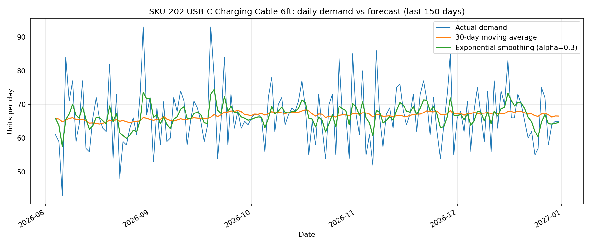
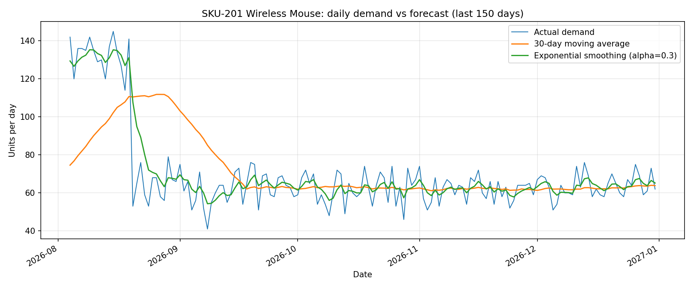
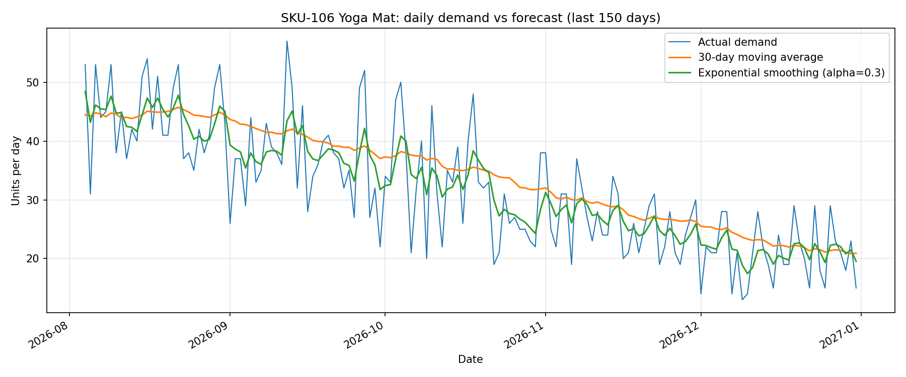

# Inventory & Demand-Forecast Analysis

> **Simulated dataset (seeded, reproducible) modeling a distribution
> operation — the analysis methods are the demonstration, not real company
> data.** Nothing in this project comes from a real company, and no
> findings here describe a real business.

## What this project is

A small distribution operation — 20 SKUs across 3 warehouses — analyzed end
to end: SQL for inventory diagnostics, Python for demand forecasting, and an
Excel model that turns the analysis into a concrete order list. The output
is a recommendations memo (`memo.md`) with specific actions: which SKUs to
reorder and how many units, which to stop replenishing, and which to leave
alone.

What this demonstrates: writing SQL against tidy data, building and
evaluating two forecasts per SKU, sizing safety stock and order quantities
from the forecast, modeling the result in Excel, and turning all of it into
written recommendations with real numbers.

## Dataset

- **20 SKUs** across **3 warehouses** (Cleveland, Columbus, Chicago), each
  SKU stocked at one warehouse.
- **365 days of daily demand** (2026-01-01 to 2026-12-31): 7,300 demand
  records, 218,146 units in total.
- Demand includes a trend per SKU, weekly seasonality (weekend uplift for
  consumer goods, weekend dip for office/packaging), annual seasonality for
  two SKUs (Yoga Mat peaks in summer, Electric Kettle peaks in winter), random
  variation, a 3-week promotion on the Wireless Mouse (demand x2.2), one
  discontinued SKU (demand stops 2026-09-28), and one very slow SKU
  (about 0.35 units/day).
- Per SKU: unit cost, supplier lead time (3–21 days), reorder point, and
  starting on-hand inventory. A daily inventory simulation (orders placed
  when inventory position falls below the reorder point, arriving after the
  lead time) produces the inventory ledger the SQL queries read.

Regenerate the exact same data with:

```
python generate_data.py
```

The generator uses fixed seed 42. Re-running it reproduces the data, and
every downstream number, exactly.

## Tools

- **SQL** (SQLite, via Python's `sqlite3` standard library — zero install)
  for the inventory diagnostics.
- **Python (pandas)** for forecasting and for building the Excel model.
- **Excel (openpyxl)** for the workbook model.
- **Matplotlib** for the demand-vs-forecast charts.

## Methods

- **Demand by SKU/warehouse:** total and average daily demand (SQL).
- **Stockout days:** days on which demand went unfilled (fulfilled <
  demand). A zero-stock day with zero demand is not counted as a stockout.
- **Inventory turnover:** COGS (fulfilled units x unit cost) / average
  inventory value.
- **Days-of-supply:** final on-hand / average daily demand (on-hand only;
  inbound orders are not counted).
- **Reorder-point breaches:** days on-hand ended below the reorder point.
  Note: on-hand sits below the reorder point for part of every normal
  replenishment cycle, so breach days alone are not treated as a problem
  signal — stockouts are.
- **Slow / dead stock:** dead = zero demand in the last 90 days; slow =
  under 1 unit/day on average in the last 90 days with stock still on hand.
- **Forecasts (per SKU):** 30-day moving average, and simple exponential
  smoothing with alpha = 0.3. Each is scored on a last-30-days holdout
  (MAPE over days with actual demand > 0); the lower-MAPE method is the
  SKU's chosen forecast.
- **Recommended order quantity:** forecast demand during the lead time +
  safety stock − on-hand, floored at 0. Safety stock = 1.65 x standard
  deviation of daily demand x sqrt(lead time), i.e. a 95% service level.
  Dead-stock SKUs get a recommended order of 0 regardless of the formula.

## Key findings

- **Service:** 215,780 of 218,146 demanded units were fulfilled — a 98.92%
  fill rate, with 2,366 units unfilled. 8 of 20 SKUs stocked out at least
  once, but four SKUs account for 99.5% of unfilled units.
- **Worst stockout:** SKU-201 Wireless Mouse — 20 stockout days, 1,511
  unfilled units. A 3-week July promotion (demand x2.2) met a 21-day lead
  time, the longest in the operation: replenishment could not arrive in
  time. Recommended order now: **724 units**.
- **Discontinued line:** SKU-203 Bluetooth Speaker Mini stocked out 22
  days (372 unfilled units, all before demand stopped on 2026-09-28), and
  now holds **510 dead units worth $11,724.90** — about 17% of the
  operation's $69,692.48 total on-hand value. Recommendation: stop
  replenishment; review for clearance, bundling, or return to supplier.
- **Seasonal peaks broke stock:** SKU-106 Yoga Mat (summer peak) stocked
  out 14 days (357 units); SKU-105 Electric Kettle (winter peak) stocked
  out 9 days (115 units) and ends the year at **0 units on hand**.
  Recommended orders: 81 and 169 units.
- **Thin cover at year end:** SKU-303 Desk Organizer Tray at 1.7 days of
  supply, SKU-205 Resistance Band Set at 3.4 days, SKU-102 Stainless Steel
  Water Bottle at 3.5 days. Total recommended orders: **1,853 units across
  16 SKUs**. Three SKUs need no order at all (SKU-101, SKU-301, SKU-307).
- **Forecast accuracy:** median chosen-method MAPE on the holdout is
  22.16%. Best: SKU-201 at 7.67% and SKU-202 USB-C Charging Cable at 8.69%
  (both exponential smoothing). Worst: SKU-308 Specialty Label Roll at
  53.12% (tiny sporadic counts inflate percentage errors) and SKU-304
  Whiteboard Marker Set at 41.44%. Moving average won for 11 SKUs,
  exponential smoothing for 9 — neither method wins everywhere.
- **Turnover:** fastest are SKU-102 (45.30x), SKU-301 Ballpoint Pen Box
  (44.90x), and SKU-202 (44.89x); slowest is SKU-308 (23.32x).

Full detail: `memo.md` (prose + action table) and `inventory_model.xlsx`
(Inputs & Assumptions, Demand, Forecast, Inventory Health, Recommendations).

## Demand vs forecast charts







## How to run

Run in this order (use `python3` instead of `python` on macOS/Linux):

```
python generate_data.py     # build the synthetic dataset (seed 42)
python run_sql.py           # load it into SQLite, run the queries -> outputs/
python forecast.py          # forecasts, MAPE, order quantities, charts
python build_workbook.py    # inventory_model.xlsx from the computed outputs
```

`memo.md` and this README are written from the computed outputs; if the
data is regenerated with a different seed, re-check their numbers against
`outputs/` before publishing.

## File map

```
generate_data.py     - synthetic data generator (seed 42)
run_sql.py           - loads CSVs into SQLite, runs sql/ queries -> outputs/
forecast.py          - per-SKU forecasts, MAPE, order quantities, charts
build_workbook.py    - builds inventory_model.xlsx from the computed outputs
memo.md              - recommendations memo: findings + action table
README.md            - this file
inventory_model.xlsx - Inputs & Assumptions, Demand, Forecast, Inventory Health, Recommendations
data/
  products.csv           - 20 SKUs: cost, lead time, reorder point, starting stock
  demand_daily.csv       - 7,300 rows: daily demand per SKU
  inventory_daily.csv    - 7,300 rows: simulated daily inventory ledger
  inventory_snapshot.csv - final-day on-hand per SKU
sql/
  01_demand_by_sku_warehouse.sql
  02_stockout_days.sql
  03_turnover.sql
  04_days_of_supply.sql
  05_reorder_breaches.sql
  06_slow_moving.sql
outputs/
  demand_by_sku.csv, stockout_days.csv, turnover.csv, days_of_supply.csv,
  reorder_breaches.csv, slow_moving.csv, forecast.csv, forecast_daily.csv
charts/
  forecast_SKU-202.png, forecast_SKU-201.png, forecast_SKU-106.png
```

## Limitations

- **Synthetic data.** The dataset is simulated and seeded. The methods are
  the demonstration, not real company data, and the findings describe this
  simulated operation only.
- **No enterprise-system experience claimed.** Nothing here uses or claims
  hands-on experience with SAP, ERP, or warehouse management systems, and
  no professional supply-chain job experience is claimed. The analysis is
  SQL, Python, and Excel on flat files.
- **A forecast is a planning aid, not a guarantee.** Holdout MAPE ranges
  from 7.67% to 53.12% across SKUs. Recommended orders pair the forecast
  with safety stock for exactly that reason and should be re-run as new
  demand arrives.
- **Fixed lead times, lost sales, no transfers.** Lead times are treated as
  fixed (supplier variability is not modeled), unfilled demand is treated
  as lost rather than backordered, and each SKU sits in one warehouse (no
  inter-warehouse transfers are modeled).
